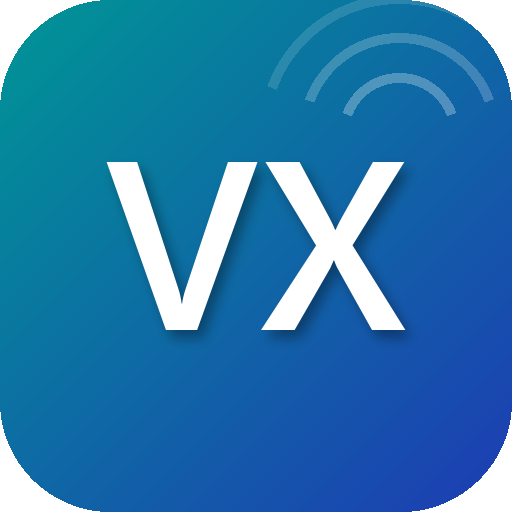

# VDExtra



VDExtra is a fork of [ghitori/vdplus](https://github.com/ghitori/vdplus), relicensed and
maintained independently under the same MIT terms. All credit for the original design and
native-hook implementation goes to [ghitori](https://github.com/ghitori). This fork swaps in a
new app identity (package, icon) and adds proper i18n to the module's own UI, with English as
the default language and Chinese available as an alternate locale (the module's own UI was
previously Chinese-only; the original project's *interface translation* feature, which patches
Virtual Desktop's own UI text, is unrelated and unchanged).

## About

This project is an **LSPosed** enhancement module for Virtual Desktop (a VR streaming client).

> For Android (arm64-v8a) + LSPosed (libxposed API 102) / verified on Quest 3 + Virtual Desktop 1.34.22

## Features

- **Interface translation** — pick which language to inject over Virtual Desktop's English UI, from the bundled per-language dictionaries, with a CJK font fix.
- **Disable background music** — stop auto-playing music while not connected.
- **Disable performance cue sounds** — independently mute 7 cue sounds ~(no more jump scares)~.
- **Extended bitrate range** — raise the desktop / VR max bitrate (1-3x multiplier, default 2x).
- **Remove auto speed-test bitrate cap** — reapply settings without the post-speedtest bandwidth cap.
- **Force LAN discovery** — keep scanning for local devices even when the remote server is unreachable (for restrictive networks).
- **More features in progress~**

## Install

1. Download `app-release.apk` from Releases and install it.
2. Enable **VDExtra** in LSPosed; its static scope defaults to **Virtual Desktop**.
3. Force-stop and restart Virtual Desktop.

## Build

Requires JDK 17 and the Android SDK (compileSdk 34, NDK 27.0.12077973, CMake).

```bash
export JAVA_HOME=/path/to/jdk-17
./gradlew :app:assembleRelease
```

## Adding a translation

A language is just a dictionary file named after its BCP-47 tag:

```
app/src/main/assets/dict/<tag>.json      e.g. zh.json, fr.json, pt-BR.json
```

Each file maps Virtual Desktop's own English UI string to its translation. Any string absent
from the file is left untouched, so a partial dictionary is perfectly valid:

```json
{
  "Unable to retrieve your computers": "无法获取您的电脑列表",
  "Connect": "连接"
}
```

Drop the file in and rebuild — it appears in the UI-language picker automatically. There is no
list to register it in and no code to change; the picker enumerates `assets/dict/` and takes
each language's display name from its tag.

One caveat worth knowing: Virtual Desktop's own font is swapped for a full-coverage one only
when a string contains a codepoint above `U+2E7F` (`hasCjk` in `native.cpp`). Latin-script
languages render on the stock font and need nothing extra, but scripts below that threshold
that the stock font lacks — Cyrillic and Greek in particular — need that check generalised
first, or they render as missing-glyph boxes.

## Notes

- This module does not provide anything related to store authorization! Make sure your account owns a legitimate Virtual Desktop purchase.
- Setting the bitrate multiplier too high may exceed your encode/decode/network capacity, causing stutter or latency — choose a sensible max bitrate.

## License

[MIT](LICENSE). Original work © [ghitori](https://github.com/ghitori) ([ghitori/vdplus](https://github.com/ghitori/vdplus)). Modifications © git-morin.
