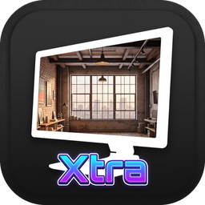

  
  <h1>VDExtra</h1>

  
  

Xposed module to add extra features to **Virtual Desktop** (VR).

> Does not circumvent the license requirement from the application. Please buy the software legitimately [here](https://www.vrdesktop.net/) !

⚠️ EARLY STAGE ⚠️

This project is in its early stages. Currently tested only on my own personal hardware:
- arm64-v8a (Quest 3)
- libxposed API 102 
- Virtual Desktop 1.34.22

**The module may misbehave by either not changing anything in **VD** (failed to hook internals of the app) or by crashing VD at launch (which in the Quest translate to a long load and then a dialog about the app not responding).
If you meet these two situations then please open an issue with your hardware specifications and the **VD** version that you are running.**

## Features

- **Interface translation**: Translate **VD**'s UI in one of the currently supported languages
  - Contributions to new languages are welcomed. Feel free to submit a merge request (see the [translation doc](docs/translations.md))
  - Resize of some elements for better fit in languages with more symbols.
- **Extend bitrate range**: Increase the allowed maximum bitrate between **VD** and the connected machine.
  - ⚠️ Make sure to stay within your bandwidth, you will get choppy performance if you push this beyond your network capacity.
- **Remove internal bitrate cap**: Prevent the measured bandwidth (internally from **VD**) from throttling what actually gets streamed.
  - ⚠️ Does not magically give you bandwidth. This is to prevent **VD** from meddling with the bitrate's current value when it does its own internal bandwidth check.
  - Generally you want this active if you use `Extend bitrate range`.
- **Custom background music**: Changes the song and volume of the music playing when **VD** isn't connected to a machine.
  - 🐱🌙 Connects to [Nightwave Plaza](https://plaza.one/) by default.
  - For your own song, you need the file locally in the device.
- **Disable performance cue sounds**: Mute the sounds that are played when you edit **VD**'s performance slider.
- **Force LAN discovery**: Find local PCs even when the remote server is unreachable (fixes some restrictive networks).

## Install

1. Download `vdextra-<version>.apk` from [Releases](../../releases) or the Xposed modules repo and install it.
2. Enable **VDExtra** in your Xposed manager; its static scope should default to Virtual Desktop.
   1. Make sure the **Virtual Desktop** app is checked in the module's app scope. 
3. Restart Virtual Desktop if it was running. This is required whenever you change the module's config.
   1. Open the companion app to configure the module further than its default.

## License

[MIT](LICENSE).
